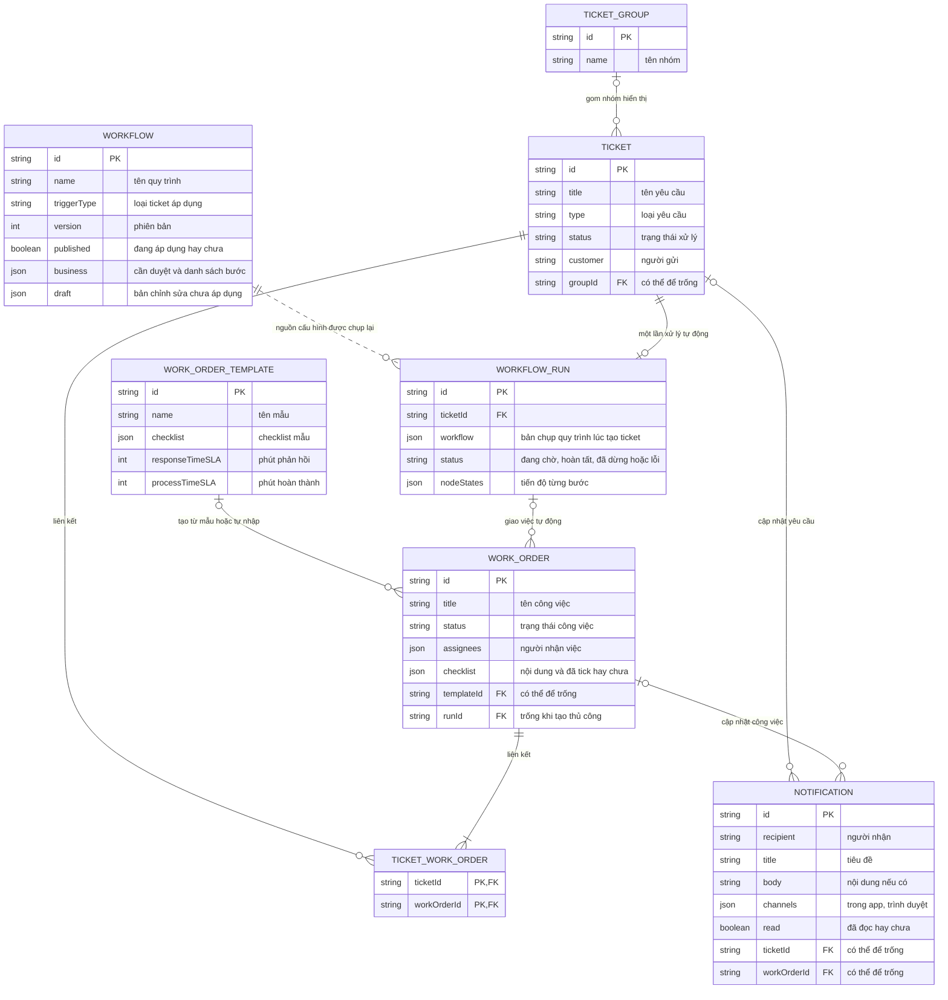
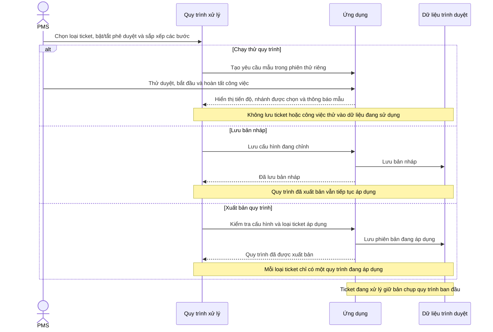
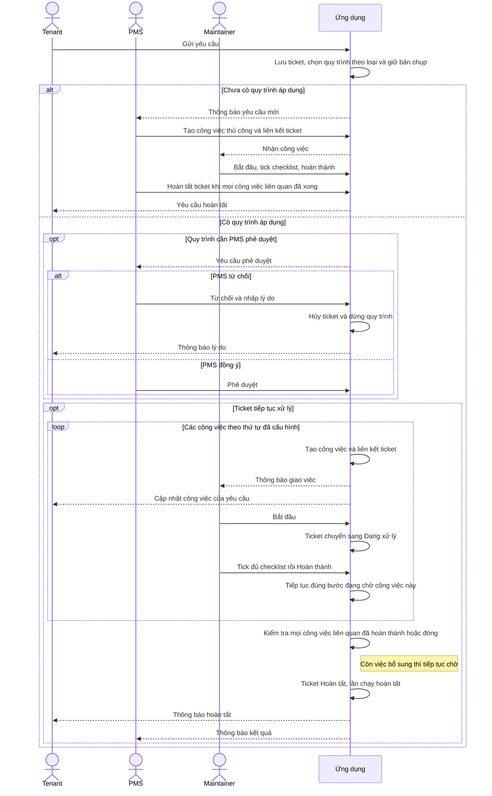

# Workflow đang dùng trên web

Tài liệu này mô tả màn hình React hiện tại: **Tenant, PMS và Maintainer**. Đọc [trang review trực quan](diagrams/review.html) để xem và phóng to 3 sơ đồ.

## Quy trình trên web gồm những gì?

PMS vào **Quy trình xử lý**, chọn loại ticket, bật/tắt phê duyệt và sắp xếp các bước. Khi Tenant hoặc PMS tạo ticket đúng loại, ứng dụng áp dụng quy trình đã xuất bản. Maintainer thực hiện các công việc được giao; PMS xem kết quả ở **Tiến độ & nhật ký**.

| Bước trên màn cấu hình | Khi quy trình chạy |
| --- | --- |
| Công việc | Giao việc với người nhận, checklist và thời hạn. Mặc định chờ hoàn thành trước khi đi tiếp. |
| Thông báo | Gửi tiêu đề/nội dung đến vai trò đã chọn. Có thông báo trong app và tùy chọn thêm thông báo trình duyệt. |
| Nhóm song song | Bắt đầu các nhánh cùng lúc; bước sau nhóm chờ tất cả nhánh đang thực hiện xong. |
| Điều kiện — Kiểm tra ngay | Đọc trạng thái hiện tại, chọn nhánh Đúng hoặc Không đúng một lần. |
| Điều kiện — Chờ trạng thái | Đi tiếp ngay nếu đã khớp; nếu chưa, chờ ticket/công việc đạt trạng thái đã chọn. |

Ví dụ: **duyệt → kiểm tra điều hòa → sửa chữa → hoàn tất**. Có thể thay phần kiểm tra bằng nhóm song song “kiểm tra điện” và “kiểm tra nước”; sau nhóm mới chạy bước tiếp theo.

## 1. Dữ liệu web đang dùng

Ticket là yêu cầu cần xử lý. Work order là công việc được giao để xử lý yêu cầu. Workflow là cấu hình PMS xuất bản; run là một lần áp dụng cấu hình đó cho một ticket. Sơ đồ chỉ giữ các trường cần để hiểu quan hệ.

[Xem SVG](diagrams/01-database.svg) · [Mermaid source](diagrams/01-database.mmd)

Các quan hệ cần nhớ:

- **Một ticket có nhiều công việc; một công việc có thể xử lý nhiều ticket.** `links[]` lưu từng cặp ticket–work order. Khi tạo công việc thủ công, PMS có thể chọn nhiều ticket.
- **Nhóm ticket chỉ để sắp xếp danh sách.** Đưa vào cùng nhóm không gộp yêu cầu, quyền duyệt hoặc tiến độ xử lý.
- **Cấu hình quy trình khác với lần chạy.** Sửa quy trình tác động đến ticket mới sau khi xuất bản; ticket đã bắt đầu giữ bản chụp riêng.
- **Mẫu công việc là nội dung để tái sử dụng.** Checklist, người nhận và thời hạn của công việc được giữ theo cấu hình lúc giao.

Dữ liệu thực tế nằm trong IndexedDB `smartos-maintenance-v1`, object store `state`, key `current`. Các entity trong hình là mảng/object của một state JSON, không phải bảng SQL. PK/FK biểu thị ID và quan hệ logic. Các field phụ như vị trí, ảnh bằng chứng, SLA, người/thời gian cập nhật được lược bớt để dễ đọc. Người dùng demo được định nghĩa trong mã.

## 2. PMS cấu hình và áp dụng quy trình

Tương ứng màn PMS → Quy trình xử lý. Có 3 thao tác khác nhau: Chạy thử kiểm tra bằng dữ liệu mẫu; Lưu bản nháp giữ để sửa tiếp; Xuất bản quy trình áp dụng cho ticket mới.

[Xem SVG](diagrams/02-configure.svg) · [Mermaid source](diagrams/02-configure.mmd)

## 3. Từ yêu cầu đến hoàn tất

Tương ứng Tenant → Yêu cầu của tôi, PMS → Thông báo / Tiến độ & nhật ký và Maintainer → Công việc của tôi. Ví dụ dưới đây dùng quy trình xuất bản từ màn cấu hình, có phê duyệt và các công việc chờ hoàn thành trước khi đi tiếp.

[Xem SVG](diagrams/03-ticket.svg) · [Mermaid source](diagrams/03-ticket.mmd)

## Các quy tắc ảnh hưởng đến tiến độ

- Tắt “Chờ hoàn thành trước khi tiếp tục” chỉ cho phép đi tiếp sau khi giao việc. **Hoàn tất ticket vẫn chờ mọi công việc liên quan**, kể cả công việc PMS thêm thủ công.
- Điều kiện dùng trạng thái hiện tại của ticket hoặc công việc đã được tạo chắc chắn ở bước trước. Nhánh bị bỏ qua không giao việc và không gửi thông báo.
- Maintainer phải bắt đầu công việc và tick đủ checklist mới có thể hoàn thành. Có thể tạm dừng rồi tiếp tục.
- Khi hủy ticket, công việc dùng chung được giữ nếu còn ticket liên kết chưa hủy. Run đã dừng không tạo công việc tiếp theo.
- Nếu một bước lỗi, PMS thấy lỗi tại “Tiến độ & nhật ký” và có thể bấm “Thử lại bước xử lý”; công việc đã tạo thành công không được tạo lại.

**Điểm hiện có trong mẫu điều hòa cài sẵn:** thông báo PMS nằm trước thao tác hoàn tất ticket. Nếu PMS giao thêm việc, thông báo đó có thể đến khi ticket vẫn đang chờ. Quy trình xuất bản từ màn cấu hình đặt thông báo PMS sau khi ticket thực sự hoàn tất, như sơ đồ trên.

## Đồng bộ giữa ba vai trò

Sau mỗi thao tác đã lưu, các tab đọc lại dữ liệu và cập nhật màn hình/thông báo. Cần mở cùng origin và cùng profile trình duyệt. Reload giữ dữ liệu; phiên chạy thử chỉ tồn tại trong bộ nhớ. Thông báo trình duyệt cần bật và cấp quyền.

Đọc [hướng dẫn thao tác](UX.md) hoặc [quy tắc dữ liệu và trạng thái](LOGIC.md) khi cần chi tiết hơn.
